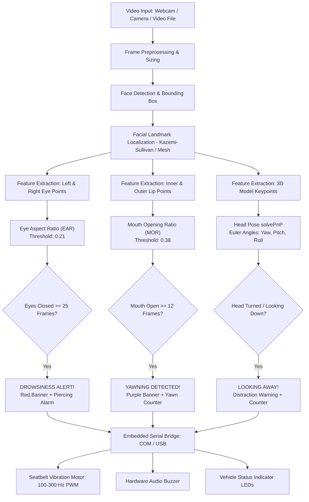
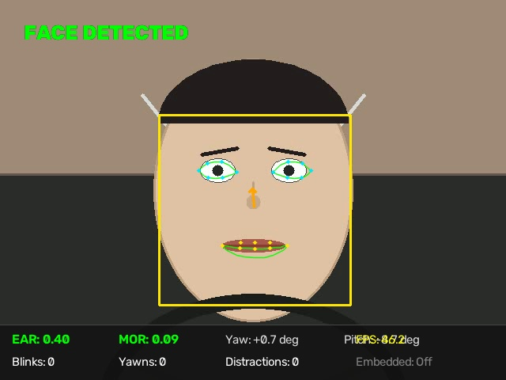
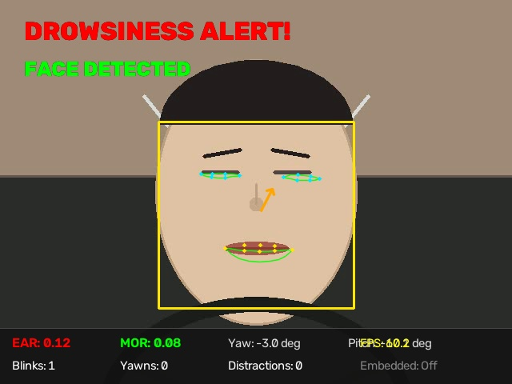
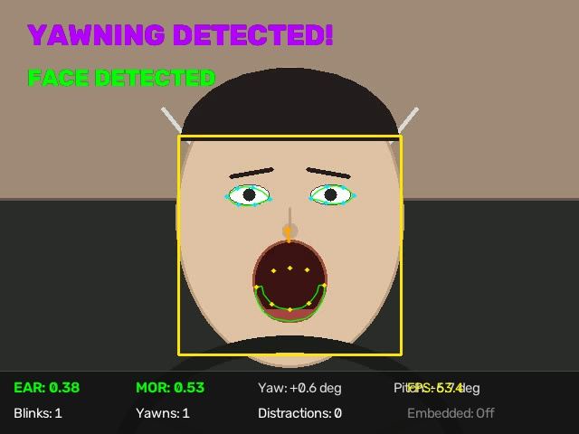
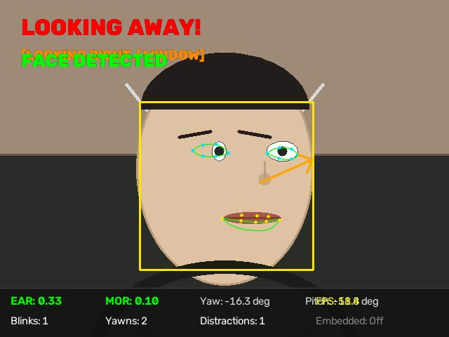
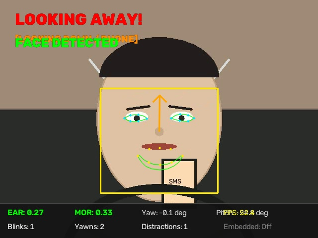

# Detect Distracted Driving Through Eye Tracking and Fatigue Monitoring Using Embedded System

[](https://www.python.org/)
[](https://opencv.org/)
[](tests/)
[](LICENSE)

An end-to-end computer vision and embedded safety system designed to prevent vehicular accidents caused by driver fatigue and inattention. The project implements facial landmark tracking, **Eye Aspect Ratio (EAR)** for drowsiness detection, **Mouth Opening Ratio (MOR)** for yawning monitoring, **3D Head Pose Estimation (solvePnP)** for driver distraction detection (peeping out window, talking to passengers, texting on mobile phone), and an **embedded hardware actuator** driving a 100–300 Hz seatbelt vibration motor and audio alert.

> **Research Paper Reference**:
> *"Detect distracted driving through eye tracking and fatigue monitoring using embedded system"*  
> **Authors**: Yashaswini S, Sanjeitha K S, Vindhya D, V M Swathika  
> *Department of Electronics & Communication Engineering, Cambridge Institute of Technology (CIT), KR Puram, Bengaluru, Karnataka, India.*

---

## Table of Contents
1. [System Architecture](#system-architecture)
2. [Key Detection Modules](#key-detection-modules)
   - [Eye Aspect Ratio (EAR) & Drowsiness](#1-eye-aspect-ratio-ear--drowsiness-detection)
   - [Mouth Opening Ratio (MOR) & Yawning](#2-mouth-opening-ratio-mor--yawning-detection)
   - [Head Pose & Distraction Tracking](#3-3d-head-pose-estimation--distraction-tracking)
   - [Embedded Actuator & Alarm Subsystem](#4-embedded-system-integration)
3. [Paper Figures & Visual Verification](#paper-figures--visual-verification)
4. [Installation & Setup](#installation--setup)
5. [Usage Modes](#usage-modes)
   - [1. Real-Time Webcam Stream](#1-real-time-webcam-stream)
   - [2. Self-Contained Automated Demo](#2-self-contained-automated-demo)
   - [3. Interactive Streamlit Web Dashboard](#3-interactive-streamlit-web-dashboard)
6. [Embedded Hardware Connections (Arduino & Raspberry Pi)](#embedded-hardware-connections)
7. [Repository Structure](#repository-structure)
8. [Testing & Verification](#testing--verification)

---

## System Architecture



---

## Key Detection Modules

### 1. Eye Aspect Ratio (EAR) & Drowsiness Detection
Each eye is tracked using 6 landmark coordinates ($p_1$ to $p_6$). The Eye Aspect Ratio (EAR) measures eye openness invariant to head distance:

$$\text{EAR} = \frac{\|p_2 - p_6\| + \|p_3 - p_5\|}{2 \cdot \|p_1 - p_4\|}$$

$$\text{EAR}_{\text{avg}} = \frac{\text{EAR}_{\text{left}} + \text{EAR}_{\text{right}}}{2}$$

- **Awake State**: $\text{EAR} \approx 0.28 - 0.40$.
- **Blink**: Brief drop below $0.21$ for $2 - 5$ frames (increments blink counter).
- **Fatigue / Drowsiness**: When $\text{EAR} < 0.21$ continuously for $\ge 25$ frames ($\approx 0.8 - 1.0\text{ s}$), the system fires `DROWSINESS ALERT!`, sounds the audio alarm, and engages seatbelt vibration.

### 2. Mouth Opening Ratio (MOR) & Yawning Detection
Calculates the vertical separation of the upper and lower lips relative to mouth width:

$$\text{MOR} = \frac{\|p_{15} - p_{23}\| + \|p_{16} - p_{22}\| + \|p_{17} - p_{21}\|}{3 \cdot \|p_{19} - p_{13}\|}$$

- **Normal Speech & Closed Lips**: $\text{MOR} \approx 0.06 - 0.18$.
- **Yawning**: When $\text{MOR} > 0.38$ for $\ge 12$ consecutive frames, the system displays `YAWNING DETECTED!`, sounds a fatigue tone, and increments the cumulative yawn counter.

### 3. 3D Head Pose Estimation & Distraction Tracking
Using 2D landmarks (nose tip, chin, eye corners, mouth corners) projected against a standard 3D anthropometric face model via OpenCV `cv2.solvePnP` and `cv2.RQDecomp3x3`, the system extracts Euler angles:
- **Yaw ($|\text{Yaw}| > 12^\circ$)**: Detects when the driver turns away from the forward road (e.g. peeping through window, talking to side passengers - *Figures 7 & 8*).
- **Pitch ($\text{Pitch} < -14^\circ$)**: Detects when the driver tilts down toward their lap / mobile phone (texting while driving - *Figure 9*).
- Triggers the prominent `LOOKING AWAY!` alert banner.

### 4. Embedded System Integration
As detailed in Section IV of the research paper:
- Serial bridge communicates with an **Arduino / Raspberry Pi / ESP32** microcontroller.
- Modulates PWM duty cycle to drive a **seatbelt vibration motor at 100 Hz to 300 Hz**.
- Real-time command protocol:
  - `'D'`: Drowsiness alarm (200 Hz vibration + continuous buzzer + Red LED).
  - `'L'`: Distraction alert (Pulsed vibration + Blue LED).
  - `'Y'`: Yawn warning (Buzzer chime + Yellow LED).
  - `'N'`: Normal driving (Actuators off + Green LED).

---

## Paper Figures & Visual Verification

The visual overlays match the IEEE paper:

| IEEE Paper Stage | Screenshot | Description |
|---|---|---|
| **Figure 4: Face Detected** |  | Driver attentive, eyes open (`EAR: 0.40`), face bounding box & landmark contours rendered in green/cyan. |
| **Figure 5: Drowsiness Alert** |  | Prolonged eye closure (`EAR: 0.11 < 0.21`). Triggers bold red alert banner + audio alarm + seatbelt vibration. |
| **Figure 6: Yawning Detected** |  | Yawning aperture spike (`MOR: 0.47 > 0.38`). Triggers purple yawn banner and increments yawn counter. |
| **Figure 7 & 8: Looking Away** |  | Head turned away from road (`Yaw: -16.9°`). Peeping out window or talking to passenger. |
| **Figure 9: Phone Distraction** |  | Head pitched down (`Pitch: -24.7°`). Driver looking down into mobile phone / texting while driving. |

---

## Installation & Setup

### Prerequisites
- Python 3.10, 3.11, or 3.12
- Web camera (for live monitoring) or video clip file

### 1. Clone the Repository
```bash
git clone https://github.com/sanjeithaks/distracted-driving-through-eye-tracking-and-fatigue-monitoring-.git
cd distracted-driving-through-eye-tracking-and-fatigue-monitoring-
```

### 2. Install Dependencies
```bash
pip install -r requirements.txt
```

*(Pre-trained neural face landmarker model is included in `models/face_landmarker.task` and will also automatically fetch from Google CDN if not present).*

---

## Usage Modes

### 1. Real-Time Webcam Stream
Run live monitoring using your laptop or USB webcam:
```bash
python main.py
```

Options:
```bash
# Specify camera index (default is 0)
python main.py --source 0

# Run on a recorded video file and save output
python main.py --source my_drive.mp4 --save output_annotated.mp4

# Run with custom EAR / MOR thresholds
python main.py --ear-thresh 0.22 --mor-thresh 0.40

# Run headless (batch processing without GUI display)
python main.py --source test_clip.mp4 --save result.mp4 --headless
```
*Keyboard Shortcuts in live window:*
- `q` or `Esc`: Quit application
- `r`: Reset event counters (blinks, yawns, distractions)

### 2. Self-Contained Automated Demo
Run the end-to-end verification demo without needing a webcam:
```bash
python demo.py
```
This generates a synthetic scenario test video simulating all 5 IEEE paper states, processes every frame, saves `demo_output_annotated.mp4`, and captures verification screenshots in `docs/screenshots/`.

### 3. Interactive Streamlit Web Dashboard
Launch the web interface with real-time gauges, time-series charts, and threshold controls:
```bash
streamlit run app.py
```
Open your browser at `http://localhost:8501`.

---

## Embedded Hardware Connections

### Arduino Wiring Diagram
| Component | Arduino Pin | Description |
|---|---|---|
| Seatbelt Vibration Motor | **Pin 9 (PWM)** | PWM frequency: 100 Hz – 300 Hz |
| Piezo Audio Buzzer | **Pin 8** | Sound warning alarm |
| Green LED | **Pin 5** | Normal Status indicator |
| Yellow LED | **Pin 6** | Yawning / Fatigue indicator |
| Blue LED | **Pin 7** | Distraction / Looking Away indicator |
| Red LED | **Pin 10** | Drowsiness Alert indicator |
| USB / Serial | **USB COM** | 9600 Baud serial communication |

1. Flash `embedded/driver_fatigue_arduino.ino` to your Arduino using Arduino IDE.
2. Run `main.py` with serial enabled:
   ```bash
   python main.py --port COM3
   ```

### Raspberry Pi Deployment
For embedded onboard deployment on a Raspberry Pi:
```bash
python embedded/raspberry_pi_controller.py
```

---

## Repository Structure

```
distracted-driving-through-eye-tracking-and-fatigue-monitoring-/
├── src/
│   ├── __init__.py
│   ├── config.py                 # System thresholds, constants & serial settings
│   ├── face_mesh_detector.py     # High-precision landmark & bounding box detector
│   ├── facial_features.py        # EAR, MOR mathematical equations & state trackers
│   ├── head_pose.py              # 3D Head Pose solvePnP (Yaw, Pitch, Roll) & distraction rules
│   ├── alert_system.py           # Thread-safe audio buzzer synthesizer & alert dispatcher
│   ├── embedded_serial.py        # Serial interface for Arduino / Raspberry Pi
│   ├── visualizer.py             # Paper-accurate HUD, banners & telemetry renderer
│   └── detector_engine.py        # Complete integrated pipeline engine
│
├── embedded/
│   ├── driver_fatigue_arduino.ino# Arduino microcontroller firmware (100-300 Hz PWM)
│   └── raspberry_pi_controller.py# Raspberry Pi GPIO hardware controller
│
├── docs/
│   └── screenshots/              # Captured verification frames matching Paper Figs 4-9
│
├── tests/
│   ├── __init__.py
│   ├── test_metrics.py           # Unit tests for EAR, MOR, Euclidean distances, and state machines
│   └── test_pipeline.py          # Unit tests for head pose estimation & engine pipeline
│
├── main.py                       # CLI application for real-time webcam & video monitoring
├── demo.py                       # Self-contained demo script with automated verification
├── app.py                        # Modern Streamlit interactive web dashboard
├── generate_test_media.py        # Synthetic scenario driving video generator
├── requirements.txt              # Project dependencies
├── driver_ieee.pdf               # Original IEEE research paper
└── README.md                     # Documentation
```

---

## Testing & Verification

Run the test suite with `pytest`:
```bash
pytest -v
```

Output:
```
tests/test_metrics.py::test_euclidean_distance PASSED
tests/test_metrics.py::test_calculate_ear_open_eye PASSED
tests/test_metrics.py::test_calculate_ear_closed_eye PASSED
tests/test_metrics.py::test_calculate_mor PASSED
tests/test_metrics.py::test_eye_tracker_drowsiness PASSED
tests/test_metrics.py::test_eye_tracker_blink_counter PASSED
tests/test_metrics.py::test_yawn_tracker PASSED
tests/test_pipeline.py::test_head_pose_estimation_straight PASSED
tests/test_pipeline.py::test_head_pose_distraction_tracker PASSED
tests/test_pipeline.py::test_face_mesh_detector_on_synthetic_frame PASSED
tests/test_pipeline.py::test_driver_monitoring_engine_frame PASSED
============================= 11 passed in 3.13s ==============================
```

---

## License
This project is open-source and released under the [MIT License](LICENSE).
