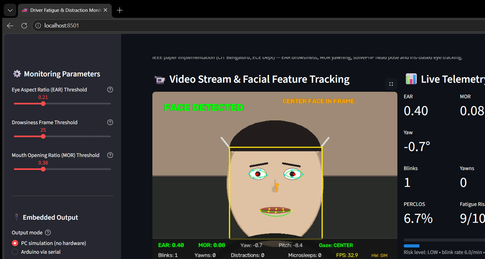
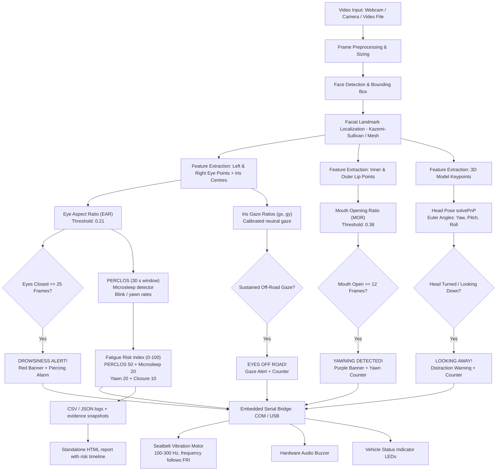
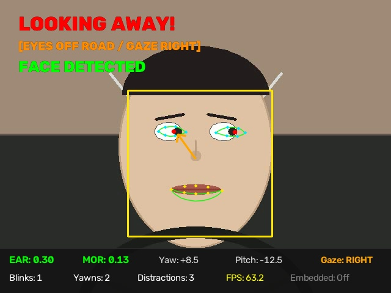
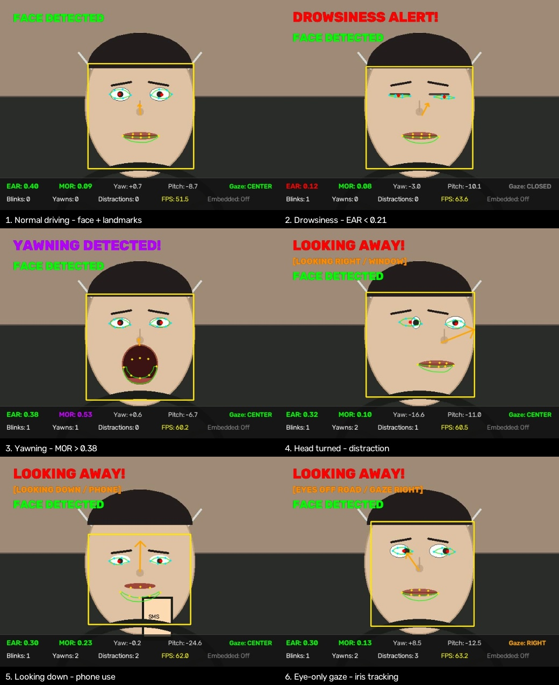
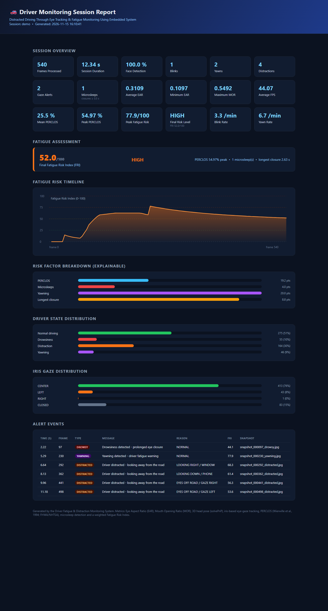

# Detect Distracted Driving Through Eye Tracking and Fatigue Monitoring Using Embedded System

[](https://www.python.org/)
[](https://opencv.org/)
[](tests/)
[](LICENSE)

An end-to-end computer vision and embedded safety system designed to prevent vehicular accidents caused by driver fatigue and inattention. The project implements facial landmark tracking, **Eye Aspect Ratio (EAR)** for drowsiness detection, **Mouth Opening Ratio (MOR)** for yawning monitoring, **3D Head Pose Estimation (solvePnP)** for driver distraction detection (peeping out window, talking to passengers, texting on mobile phone), **iris-based eye-gaze tracking** for eyes-off-road detection, **PERCLOS + microsleep detection**, and a research-grade **composite Fatigue Risk Index (FRI)**. The embedded subsystem drives a 100–300 Hz seatbelt vibration motor whose frequency follows the live fatigue score, plus audio/LED alerts. Every session is logged to CSV/JSON with evidence snapshots and exported as a standalone HTML report.

> **Research Paper Reference**:
> *"Detect distracted driving through eye tracking and fatigue monitoring using embedded system"*  
> **Authors**: Yashaswini S, Sanjeitha K S, Vindhya D, V M Swathika  
> *Department of Electronics & Communication Engineering, Cambridge Institute of Technology (CIT), KR Puram, Bengaluru, Karnataka, India.*

---

## 🚀 Quick Start (Windows — easiest way)

| I want to… | Double-click | What happens |
|---|---|---|
| Install dependencies once | **`INSTALL.bat`** | Installs `requirements.txt` |
| **Open the web working model** | **`START_WEB_DASHBOARD.bat`** | Opens the Streamlit dashboard at `http://localhost:8501` |
| Run the live webcam | **`START_LIVE_CAMERA.bat`** | Opens a webcam window; press `q` / `Esc` to stop |
| Run without a camera | **`START_DEMO.bat`** | Processes 6 scenarios and writes the HTML report |

**Dashboard steps:** double-click `START_WEB_DASHBOARD.bat` → browser opens →
choose *Run Built-in Demo Clip* / *Upload Driving Video File* / *Live Webcam Stream* in
the sidebar → press **🚀 Start Monitoring**. Keep the terminal window open while using it.

> **No Arduino or Raspberry Pi? No problem.** Everything runs in **PC simulation mode by
> default**. The dashboard shows a virtual seatbelt motor, buzzer and LEDs, and the HUD
> shows `HW: SIM`. Hardware is optional and only used if you explicitly enable it.



### Manual commands (any OS)

```bash
python -m pip install -r requirements.txt

# Web working model (recommended)
python -m streamlit run app.py        # open http://localhost:8501

# Live webcam window
python main.py                        # q / Esc to quit

# Automated demo, no camera
python demo.py
```

> If your Windows camera is low, raise it so your **whole face sits in the upper-middle**
> of the frame. The live HUD shows `CENTER FACE IN FRAME` when the face is cut off.

---

## Table of Contents
1. [System Architecture](#system-architecture)
2. [Key Detection Modules](#key-detection-modules)
   - [Eye Aspect Ratio (EAR) & Drowsiness](#1-eye-aspect-ratio-ear--drowsiness-detection)
   - [Mouth Opening Ratio (MOR) & Yawning](#2-mouth-opening-ratio-mor--yawning-detection)
   - [Head Pose & Distraction Tracking](#3-3d-head-pose-estimation--distraction-tracking)
   - [Iris Eye-Gaze Tracking](#4-iris-based-eye-gaze-tracking)
   - [PERCLOS, Microsleeps & Fatigue Risk Index](#5-perclos-microsleeps--fatigue-risk-index)
   - [Embedded Actuator & Alarm Subsystem](#6-embedded-system-integration)
   - [Session Logging, Snapshots & Reports](#7-session-logging-snapshots--reports)
3. [Paper Figures & Visual Verification](#paper-figures--visual-verification)
4. [Installation & Setup](#installation--setup)
5. [Usage Modes](#usage-modes)
   - [1. Real-Time Webcam Stream](#1-real-time-webcam-stream)
   - [2. Self-Contained Automated Demo](#2-self-contained-automated-demo)
   - [3. Interactive Streamlit Web Dashboard](#3-interactive-streamlit-web-dashboard)
6. [Embedded Hardware Connections (Arduino & Raspberry Pi)](#embedded-hardware-connections)
7. [Repository Structure](#repository-structure)
8. [Testing & Verification](#testing--verification)
9. [Research References](#research-references)

---

## System Architecture



---

## Key Detection Modules

### 1. Eye Aspect Ratio (EAR) & Drowsiness Detection
Each eye is tracked using 6 landmark coordinates ($p_1$ to $p_6$). The Eye Aspect Ratio (EAR) measures eye openness invariant to head distance:

$$\text{EAR} = \frac{\|p_2 - p_6\| + \|p_3 - p_5\|}{2 \cdot \|p_1 - p_4\|}$$

$$\text{EAR}_{\text{avg}} = \frac{\text{EAR}_{\text{left}} + \text{EAR}_{\text{right}}}{2}$$

- **Awake State**: $\text{EAR} \approx 0.28 - 0.40$.
- **Blink**: Brief drop below $0.21$ for $2 - 5$ frames (increments blink counter).
- **Fatigue / Drowsiness**: When $\text{EAR} < 0.21$ continuously for $\ge 25$ frames ($\approx 0.8 - 1.0\text{ s}$), the system fires `DROWSINESS ALERT!`, sounds the audio alarm, and engages seatbelt vibration.

### 2. Mouth Opening Ratio (MOR) & Yawning Detection
Calculates the vertical separation of the upper and lower lips relative to mouth width:

$$\text{MOR} = \frac{\|p_{15} - p_{23}\| + \|p_{16} - p_{22}\| + \|p_{17} - p_{21}\|}{3 \cdot \|p_{19} - p_{13}\|}$$

- **Normal Speech & Closed Lips**: $\text{MOR} \approx 0.06 - 0.18$.
- **Yawning**: When $\text{MOR} > 0.38$ for $\ge 12$ consecutive frames, the system displays `YAWNING DETECTED!`, sounds a fatigue tone, and increments the cumulative yawn counter.

### 3. 3D Head Pose Estimation & Distraction Tracking
Using 2D landmarks (nose tip, chin, eye corners, mouth corners) projected against a standard 3D anthropometric face model via OpenCV `cv2.solvePnP` and `cv2.RQDecomp3x3`, the system extracts Euler angles:
- **Yaw ($|\text{Yaw}| > 12^\circ$)**: Detects when the driver turns away from the forward road (e.g. peeping through window, talking to side passengers - *Figures 7 & 8*).
- **Pitch ($\text{Pitch} < -14^\circ$)**: Detects when the driver tilts down toward their lap / mobile phone (texting while driving - *Figure 9*).
- Triggers the prominent `LOOKING AWAY!` alert banner.

### 4. Iris-Based Eye-Gaze Tracking
Head pose alone cannot detect a driver who keeps their head straight but moves only
their eyes away from the road. This module adds true eye tracking using the **478-point
MediaPipe face mesh**, which includes the iris.

- The iris centre is normalised inside each eye:
  $$g_x = \frac{x_{\text{iris}} - x_{\text{eye,left}}}{x_{\text{eye,right}} - x_{\text{eye,left}}}, \qquad
    g_y = \frac{y_{\text{iris}} - y_{\text{eyelid,top}}}{y_{\text{eyelid,bottom}} - y_{\text{eyelid,top}}}$$
  Both ratios are approximately **0.5** when looking straight ahead.
- The neutral gaze is calibrated automatically from the first 30 frames and
  slowly adapted while the driver looks at the road.
- A sustained deviation (`gx` / `gy` outside the calibrated dead-band for
  **15 consecutive frames**) raises `LOOKING AWAY!` with the reason
  `EYES OFF ROAD / GAZE LEFT|RIGHT|UP|DOWN`.
- Gaze is ignored while the eyes are closed (`EAR < 0.21`) to avoid false alerts
  during blinks and drowsiness.
- Tuning parameters live in `src/config.py` (`GAZE_HORIZONTAL_DELTA`,
  `GAZE_VERTICAL_DELTA`, `GAZE_CONSEC_FRAMES`, `GAZE_CALIBRATION_FRAMES`).

### 5. PERCLOS, Microsleeps & Fatigue Risk Index
Drowsiness is not only a single threshold on EAR. This module adds the
research-validated **PERCLOS** metric plus a composite, explainable risk score.

- **PERCLOS** — percentage of eyelid closure over time (Wierwille et al., 1994;
  FHWA/NHTSA). Eyelid openness is estimated as `EAR / EAR_open_baseline`, and a
  frame counts as closed when openness is below 30% (≥70% closed, consistent
  with the 25–30% eye-opening definitions used in PERCLOS research). PERCLOS is
  averaged over a rolling **30 s window**.
- **Microsleeps** — continuous eye closure of **≥ 0.5 s**; the longest closure
  and number of episodes are recorded.
- **Blink rate / yawn rate** — per-minute behavioural indicators used by the risk
  model and report.
- **Fatigue Risk Index (FRI)** — a weighted 0–100 score:
  $$FRI = 50\min(1,\tfrac{PERCLOS}{0.40}) + 20\min(1,\tfrac{microsleeps}{5})
        + 20\min(1,\tfrac{yawns/min}{4}) + 10\min(1,\tfrac{longest\ closure}{3})$$
  Risk bands: **LOW** (<25), **MODERATE** (25–49), **HIGH** (50–74),
  **CRITICAL** (≥75). The exact contribution of each factor is shown live in the
  HUD and in the HTML report, so the alert is explainable rather than a black box.

### 6. Embedded System Integration
As detailed in Section IV of the research paper:
- Serial bridge communicates with an **Arduino / Raspberry Pi / ESP32** microcontroller.
- Modulates PWM duty cycle to drive a **seatbelt vibration motor at 100 Hz to 300 Hz**.
- Real-time command protocol: `"<state>,<fatigue_risk>\n"`, e.g. `"D,82\n"`.
  - `'D'`: Drowsiness alarm (continuous buzzer + Red LED + vibration).
  - `'L'`: Distraction alert (pulsed vibration + Blue LED).
  - `'Y'`: Yawn warning (buzzer chime + Yellow LED).
  - `'N'`: Normal driving (actuators off + Green LED).
- The live **Fatigue Risk Index scales the seatbelt vibration frequency**
  (`100 + 2 × FRI` Hz, i.e. 100–300 Hz) and intensity (45–100% duty), directly
  implementing the paper's variable-frequency haptic feedback.
- The firmware also has a 2.5 s heartbeat watchdog that fails safe to normal.

### 7. Session Logging, Snapshots & Reports
Every run records per-frame telemetry and alert events, which makes the project
usable for evaluation and for the results tables in the IEEE paper:

- `logs/session_<timestamp>.csv` — per-frame EAR, MOR, yaw, pitch, roll, gaze,
  counter values and alert state.
- `logs/session_<timestamp>_summary.json` — aggregated statistics and the list
  of alert events.
- `logs/session_<timestamp>_report.html` — standalone dark-themed report with
  session cards, driver-state distribution bars, gaze distribution and an event table.

Disable logging with `--no-log`, or choose another folder with `--log-dir`.
The self-contained demo writes its report to `docs/demo_report.html`.

---

## Paper Figures & Visual Verification

The visual overlays match the IEEE paper:

| IEEE Paper Stage | Screenshot | Description |
|---|---|---|
| **Figure 4: Face Detected** |  | Driver attentive, eyes open (`EAR: 0.40`), face bounding box & landmark contours rendered in green/cyan. |
| **Figure 5: Drowsiness Alert** |  | Prolonged eye closure (`EAR: 0.11 < 0.21`). Triggers bold red alert banner + audio alarm + seatbelt vibration. |
| **Figure 6: Yawning Detected** |  | Yawning aperture spike (`MOR: 0.47 > 0.38`). Triggers purple yawn banner and increments yawn counter. |
| **Figure 7 & 8: Looking Away** |  | Head turned away from road (`Yaw: -16.9°`). Peeping out window or talking to passenger. |
| **Figure 9: Phone Distraction** |  | Head pitched down (`Pitch: -24°`). Driver looking down into mobile phone / texting while driving. |
| **Figure 10: Iris Gaze Tracking** |  | Head still, eyes glance off-road (`Gaze: RIGHT`). Flanked by the live PERCLOS and Fatigue Risk HUD. |



### Final generated session report



> The complete annotated run is saved as `demo_output_annotated.mp4`, the
> generated report is [`docs/demo_report.html`](docs/demo_report.html), and the
> raw telemetry is in `docs/session_demo.csv` / `docs/session_demo_summary.json`.
> Alert evidence frames are stored in [`docs/snapshots/`](docs/snapshots/).

---

## Installation & Setup

### Prerequisites
- Python 3.10, 3.11, or 3.12
- Web camera (for live monitoring) or video clip file

### 1. Clone the Repository
```bash
git clone https://github.com/sanjeithaks/distracted-driving-through-eye-tracking-and-fatigue-monitoring-.git
cd distracted-driving-through-eye-tracking-and-fatigue-monitoring-
```

### 2. Install Dependencies
```bash
pip install -r requirements.txt
```

*(Pre-trained models are bundled in `models/`: the MediaPipe `face_landmarker.task` and the Apache-2.0 ONNX fallback models. Missing files are downloaded automatically.)*

### Face-landmark backends (automatic)
The detector selects the best available backend at runtime:

| Backend | Requirement | Notes |
|---|---|---|
| **MediaPipe FaceLandmarker** (primary) | `mediapipe` runtime can load | Fastest; 478 points with irises |
| **OpenCV-DNN ONNX** (automatic fallback) | OpenCV only | 478 points with irises; used when a Windows Application Control policy (e.g. Smart App Control) blocks MediaPipe's unsigned `libmediapipe.dll` |

No extra dependency is needed for the fallback — it runs BlazeFace + Face Landmarker
ONNX models entirely inside `cv2.dnn`. You can force it with
`FaceMeshDetector(backend="opencv-dnn")`, or inspect `engine.detector.backend`
after startup.

---

## Usage Modes

### 1. Real-Time Webcam Stream
Run live monitoring using your laptop or USB webcam:
```bash
python main.py
```

Options:
```bash
# Specify camera index (default is 0)
python main.py --source 0

# Run on a recorded video file and save output
python main.py --source my_drive.mp4 --save output_annotated.mp4

# Run with custom EAR / MOR thresholds
python main.py --ear-thresh 0.22 --mor-thresh 0.40

# Run headless (batch processing without GUI display)
python main.py --source test_clip.mp4 --save result.mp4 --headless

# Capture a timed live webcam session (25 s) and save the annotated video
python main.py --source 0 --duration 25 --save live_session.mp4

# Write session logs to a custom folder and a named HTML report
python main.py --source test_clip.mp4 --log-dir reports --report reports/my_session.html

# Disable session logging
python main.py --no-log
```
*Keyboard Shortcuts in live window:*
- `q` or `Esc`: Quit application
- `r`: Reset event counters (blinks, yawns, distractions, gaze)

### 2. Self-Contained Automated Demo
Run the end-to-end verification demo without needing a webcam:
```bash
python demo.py
```
This generates a synthetic scenario test video simulating all six monitored states
(normal, drowsiness, yawning, head-turn distraction, phone/looking-down distraction,
and eye-only gaze distraction), processes every frame, saves
`demo_output_annotated.mp4`, captures verification screenshots in
`docs/screenshots/`, and writes `docs/demo_report.html` plus the session CSV/JSON.

### 3. Interactive Streamlit Web Dashboard
Launch the web interface with real-time gauges, time-series charts, threshold controls,
session summary and downloadable CSV / HTML report:
```bash
streamlit run app.py
```
Open your browser at `http://localhost:8501`.

---

## Embedded Hardware Connections (Optional)

> **The project works fully without hardware.** By default the embedded subsystem runs
> in **PC simulation**: the seatbelt vibration frequency, buzzer and LEDs are displayed
> on screen in the Streamlit dashboard and the HUD shows `HW: SIM`. The wiring below is
> only needed if you want a physical demonstration.

### Arduino Wiring Diagram
| Component | Arduino Pin | Description |
|---|---|---|
| Seatbelt Vibration Motor | **Pin 9 (PWM)** | PWM frequency: 100 Hz – 300 Hz |
| Piezo Audio Buzzer | **Pin 8** | Sound warning alarm |
| Green LED | **Pin 5** | Normal Status indicator |
| Yellow LED | **Pin 6** | Yawning / Fatigue indicator |
| Blue LED | **Pin 7** | Distraction / Looking Away indicator |
| Red LED | **Pin 10** | Drowsiness Alert indicator |
| USB / Serial | **USB COM** | 9600 Baud serial communication |

1. Flash `embedded/driver_fatigue_arduino.ino` to your Arduino using Arduino IDE.
2. Run `main.py` with hardware output explicitly enabled:
   ```bash
   python main.py --serial --port COM3
   ```
   Without `--serial`, the system uses PC simulation and never requires a COM port.

### Raspberry Pi Deployment
For embedded onboard deployment on a Raspberry Pi:
```bash
python embedded/raspberry_pi_controller.py
```

---

## Repository Structure

```
distracted-driving-through-eye-tracking-and-fatigue-monitoring-/
├── src/
│   ├── __init__.py
│   ├── config.py                 # System thresholds, constants & serial settings
│   ├── face_mesh_detector.py     # Dual backend: MediaPipe + OpenCV-DNN ONNX fallback
│   ├── facial_features.py        # EAR, MOR mathematical equations & state trackers
│   ├── head_pose.py              # 3D Head Pose solvePnP (Yaw, Pitch, Roll) & distraction rules
│   ├── gaze_tracker.py           # Iris-based eye-gaze tracking & off-road gaze detection
│   ├── fatigue_analyzer.py       # PERCLOS, microsleeps, blink/yawn rates & Fatigue Risk Index
│   ├── alert_system.py           # Thread-safe audio buzzer synthesizer & alert dispatcher
│   ├── embedded_serial.py        # Risk-aware serial interface for Arduino / Raspberry Pi
│   ├── visualizer.py             # Paper-accurate HUD, banners & telemetry renderer
│   ├── session_logger.py         # Per-frame CSV logging, evidence snapshots & summary JSON
│   ├── report.py                 # Standalone HTML report with fatigue timeline
│   └── detector_engine.py        # Complete integrated pipeline engine
│
├── models/
│   ├── face_landmarker.task              # MediaPipe primary model
│   ├── face_detection_short_range.onnx   # OpenCV-DNN fallback detector (Apache-2.0)
│   ├── face_landmarker_Nx3x256x256.onnx  # OpenCV-DNN fallback 478-point mesh (Apache-2.0)
│   └── README.md                         # Model sources, licenses & attribution
│
├── embedded/
│   ├── driver_fatigue_arduino.ino# Arduino firmware (risk-driven 100-300 Hz PWM)
│   └── raspberry_pi_controller.py# Raspberry Pi GPIO hardware controller
│
├── docs/
│   ├── screenshots/              # Captured verification frames (Figs 4-10) + contact sheet
│   ├── snapshots/                # Alert evidence frames generated by the demo
│   ├── demo_report.html          # Generated session report with fatigue timeline
│   ├── report_preview.png        # Rendered preview of the HTML report
│   └── session_demo.csv/.json    # Generated session telemetry (demo run)
│
├── tests/
│   ├── __init__.py
│   ├── test_metrics.py           # Unit tests for EAR, MOR, Euclidean distances, and state machines
│   ├── test_gaze.py              # Iris gaze ratio & off-road gaze state machine tests
│   ├── test_fatigue.py           # PERCLOS, microsleep & Fatigue Risk Index tests
│   ├── test_logger.py            # Session logger, snapshot, summary JSON & report tests
│   └── test_pipeline.py          # Unit tests for head pose estimation & engine pipeline
│
├── logs/                         # Runtime session logs (git-ignored)
├── main.py                       # CLI application for real-time webcam & video monitoring
├── demo.py                       # Self-contained demo script with automated verification
├── app.py                        # Modern Streamlit interactive web dashboard
├── generate_test_media.py        # Synthetic scenario driving video generator
├── INSTALL.bat                   # One-click dependency installer (Windows)
├── START_WEB_DASHBOARD.bat       # One-click web working model launcher
├── START_LIVE_CAMERA.bat         # One-click live webcam launcher
├── START_DEMO.bat                # One-click automated demo launcher
├── requirements.txt              # Project dependencies
├── driver_ieee.pdf               # Original IEEE research paper
└── README.md                     # Documentation
```

---

## Testing & Verification

Run the test suite with `pytest`:
```bash
pytest -v
```

Output:
```
tests/test_metrics.py::test_euclidean_distance PASSED
tests/test_metrics.py::test_calculate_ear_open_eye PASSED
tests/test_metrics.py::test_calculate_ear_closed_eye PASSED
tests/test_metrics.py::test_calculate_mor PASSED
tests/test_metrics.py::test_eye_tracker_drowsiness PASSED
tests/test_metrics.py::test_eye_tracker_blink_counter PASSED
tests/test_metrics.py::test_yawn_tracker PASSED
tests/test_gaze.py::test_compute_gaze_ratios_centered PASSED
tests/test_gaze.py::test_compute_gaze_ratios_shifted_right PASSED
tests/test_gaze.py::test_gaze_tracker_calibrates_and_detects_off_road PASSED
tests/test_gaze.py::test_gaze_tracker_ignores_closed_eyes PASSED
tests/test_fatigue.py::test_perclos_and_microsleep_detection PASSED
tests/test_fatigue.py::test_risk_levels PASSED
tests/test_fatigue.py::test_fatigue_risk_factors_sum_to_index PASSED
tests/test_fatigue.py::test_no_face_does_not_trigger_false_fatigue PASSED
tests/test_logger.py::test_session_logger_writes_csv_and_summary PASSED
tests/test_logger.py::test_alert_evidence_snapshot PASSED
tests/test_logger.py::test_html_report_generation PASSED
tests/test_pipeline.py::test_head_pose_estimation_straight PASSED
tests/test_pipeline.py::test_head_pose_distraction_tracker PASSED
tests/test_pipeline.py::test_face_mesh_detector_on_synthetic_frame PASSED
tests/test_pipeline.py::test_driver_monitoring_engine_frame PASSED
============================= 22 passed in 13.60s ==============================
```

---

## Research References

1. Wierwille, W. W., et al. *Evaluation of Techniques for Ocular Measurement as an Index of Fatigue and as the Basis for Alertness Management.* NHTSA/FHWA, 1994. — origin of PERCLOS.
2. *PERCLOS: A Valid Psychophysiological Measure of Alertness as Assessed by Psychomotor Vigilance.* FHWA Tech Brief, 1998. https://rosap.ntl.bts.gov/view/dot/113
3. *PERCLOS-based technologies for detecting drowsiness: current evidence and future directions.* PMC, 2023. https://pmc.ncbi.nlm.nih.gov/articles/PMC10108649
4. Soukupová, T., & Čech, J. *Real-Time Eye Blink Detection Using Facial Landmarks.* 2016. — EAR formulation.
5. Kazemi, V., & Sullivan, J. *One Millisecond Face Alignment with an Ensemble of Regression Trees.* CVPR, 2014.
6. Google MediaPipe Face Mesh / Face Landmarker — https://github.com/google-ai-edge/mediapipe (Apache-2.0).
7. Yakhyokhuja Valikhujaev, *mediapipe-face-mesh-onnx* — ONNX model exports used by the OpenCV-DNN fallback (Apache-2.0). https://github.com/yakhyo/mediapipe-face-mesh-onnx

---

## License
This project is open-source and released under the [MIT License](LICENSE).

Third-party model weights in `models/` retain their original Apache-2.0 licenses;
see [`models/README.md`](models/README.md) for attribution.
